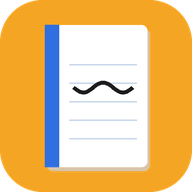
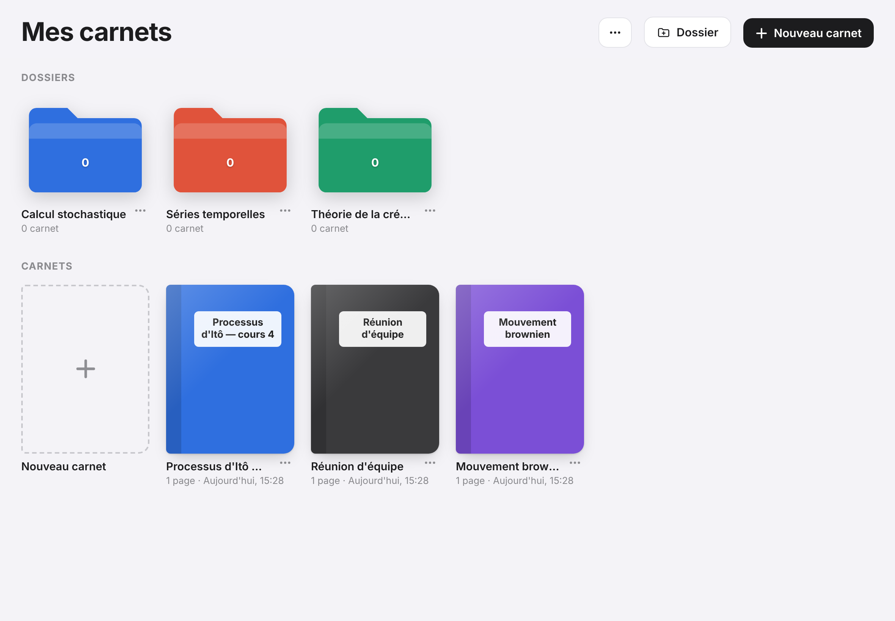
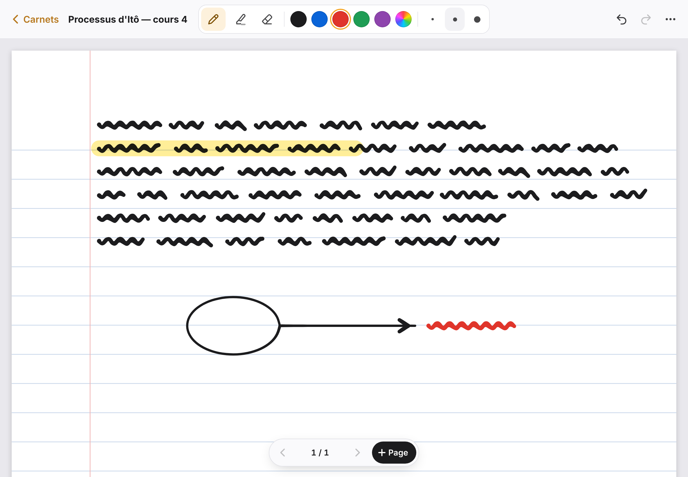

<div align="center">



# Carnet

**Prise de notes manuscrites au stylet, pensée pour la tablette.**
Une application web progressive (PWA) légère, hors ligne et sans compte : vos notes restent sur votre appareil.

[**Ouvrir l'application**](https://TON-PSEUDO.github.io/carnet/) · [Fonctionnalités](#fonctionnalités) · [Installation](#installation) · [Architecture](#architecture-technique)


</div>

---

## Aperçu

| Bibliothèque | Éditeur |
|:---:|:---:|
|  |  |

## Pourquoi ce projet

Les meilleures applications de prise de notes manuscrites sont souvent réservées à un seul écosystème, payantes ou dépendantes d'un compte en ligne.
**Carnet** propose une expérience proche de celle des carnets sur iPad. Il tourne dans n'importe quel navigateur moderne, s'installe comme une application native sur Android et fonctionne entièrement hors connexion.

## Fonctionnalités

### Écriture
- **Tracé sensible à la pression** du stylet (Apple Pencil, S Pen, stylets USI…), lissé pour un rendu naturel
- **Trois outils** : stylo, surligneur (mode *multiply*, l'encre reste lisible) et gomme qui efface le trait entier
- Palette de couleurs prédéfinies, sélecteur de couleur libre et trois épaisseurs par outil
- **Rejet de la paume** : quand un stylet est détecté, seul le stylet écrit et le doigt sert à naviguer
- **Gestes** : pincer pour zoomer, glisser à deux doigts pour se déplacer, tap à deux doigts pour annuler
- Annuler et rétablir illimités pendant la session, page par page

### Organisation
- **Dossiers et sous-dossiers** colorés pour ranger les carnets (par matière, par projet…)
- Carnets multipages avec couverture personnalisable
- Quatre types de papier : blanc, ligné, petits carreaux, pointillés
- Renommer, déplacer, supprimer : tout se fait depuis la bibliothèque

### Données
- **100 % hors ligne** : aucune connexion n'est nécessaire après l'installation
- Enregistrement automatique et instantané sur l'appareil (IndexedDB)
- **Export** d'une page en PNG haute définition ou d'un carnet complet en PDF A4
- **Sauvegarde et restauration** de tous les carnets dans un fichier JSON (vers Google Drive, par exemple)
- Aucune donnée envoyée à un serveur, aucun traceur, aucun compte

## Installation

### Utiliser l'application
1. Ouvrir **https://TON-PSEUDO.github.io/carnet/** dans Chrome (Android) ou Safari (iPad).
2. **Android** : menu ⋮ → *Installer l'application*.
   **iPad** : bouton Partager → *Sur l'écran d'accueil*.
3. Lancer **Carnet** depuis l'écran d'accueil : l'application s'ouvre en plein écran et fonctionne hors ligne.

### Lancer en local
Aucune dépendance ni étape de compilation : un simple serveur statique suffit.

```bash
git clone https://github.com/TON-PSEUDO/carnet.git
cd carnet
python3 -m http.server 8000
# puis ouvrir http://localhost:8000
```

### Déployer sa propre copie
Forker le dépôt, puis **Settings → Pages → Deploy from a branch → `main` / `(root)`**.

## Architecture technique

```
carnet/
├── index.html              # Application complète : interface, rendu, logique
├── sw.js                   # Service worker : cache hors ligne et mises à jour
├── manifest.webmanifest    # Métadonnées PWA (nom, icônes, mode plein écran)
├── icons/                  # Icônes de l'application (dont une version maskable)
├── vendor/
│   ├── perfect-freehand.mjs  # Génération des contours de trait avec pression
│   └── jspdf.umd.min.js      # Export PDF
└── docs/                   # Captures d'écran
```

| Brique | Choix technique |
|---|---|
| Saisie | Pointer Events (`pressure`, `getCoalescedEvents`) pour un tracé fluide et précis |
| Rendu | Canvas 2D en deux couches (page figée + trait en cours), mise à l'échelle *devicePixelRatio*, cache `Path2D` par trait |
| Modèle | Page logique au format A4 (1000 × 1414 unités), indépendante de la taille de l'écran et du zoom |
| Stockage | IndexedDB avec cache mémoire ; points encodés en `Int16` puis base64 (environ 2× plus compact que du JSON brut) |
| Hors ligne | Service worker *network-first* avec repli sur le cache ; toutes les dépendances sont embarquées |
| Gomme | Test de collision par boîte englobante, puis par distance point à point |

Le projet est écrit en **JavaScript natif, sans framework ni étape de build**, pour rester léger (moins de 500 Ko) et simple à maintenir.

## Feuille de route

- [ ] Outil lasso : sélectionner, déplacer et redimensionner des traits
- [ ] Reconnaissance de formes (lignes, cercles, flèches)
- [ ] Zones de texte et insertion d'images
- [ ] Import et annotation de PDF
- [ ] Recherche dans les titres de carnets
- [ ] Mode sombre

## Crédits

- [perfect-freehand](https://github.com/steveruizok/perfect-freehand) de Steve Ruiz (MIT) : rendu des traits avec pression
- [jsPDF](https://github.com/parallax/jsPDF) (MIT) : génération des PDF

## Auteur

**Dave Célestin**, étudiant en Master 2 Actuariat à Le Mans Université.

## Licence

Distribué sous licence MIT. Voir [`LICENSE`](LICENSE).
